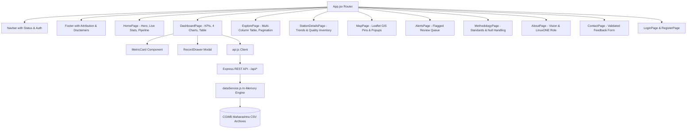

# Pani Safe — System Architecture & Technical Specification

**Event:** IBM Z Datathon 2026  
**Platform:** Pani Safe Groundwater Quality Monitoring & Risk Screening Platform  
**Target Environment:** IBM LinuxONE Community Cloud (Ubuntu on s390x architecture) & Standard x86/ARM64

---

## 1. High-Level Architecture Overview

Pani Safe is architected as a modular, decoupled full-stack environmental analytics platform designed to ingest, validate, index, screen, and visualize large-scale historical groundwater hydrochemistry datasets.

```
+-------------------------------------------------------------------------------+
|                                USER BROWSER                                   |
|   (Desktop, Laptop, Tablet, Mobile Responsive Viewport - Modern Web Standards)|
+-------------------------------------------------------------------------------+
                                      |
                                      | HTTP / HTTPS (REST API & Static Assets)
                                      v
+-------------------------------------------------------------------------------+
|                       FRONTEND LAYER (Vite + React.js)                         |
|  - Custom CSS Design System (Forest Green, Teal, Crisp Light Surfaces)        |
|  - Recharts Statistical Visualizations (pH / TDS Histograms, Trends)         |
|  - Leaflet + OpenStreetMap Spatial GIS Engine (Zero-Cost Tile Provider)      |
|  - Real-time Multi-Faceted Filter State & Compound Search Orchestration        |
|  - Slide-Over Parameter Inspection Drawer & CSV Exporter                     |
|  - Auth Context & Optional Evaluator Demo Access Session Store               |
+-------------------------------------------------------------------------------+
                                      |
                                      | JSON REST Requests (/api/*)
                                      v
+-------------------------------------------------------------------------------+
|                     BACKEND APPLICATION ENGINE (Node.js & Express)            |
|  - REST API Routing & Input Validation Middleware                             |
|  - In-Memory Multi-Indexed Query & Fast Filter Engine (Sub-5ms response)     |
|  - Compound Key Station Disambiguator (${district}_${station}_${lat}_${lon})  |
|  - Scientific Screening Validator (pH 6.5-8.5, TDS > 500 mg/L)                |
|  - Pure-JavaScript Cryptography (bcryptjs + JWT for 100% s390x compatibility)|
|  - Health & Telemetry Engine (OS Platform, Arch, Memory, Heap, Uptime)        |
+-------------------------------------------------------------------------------+
                                      |
                                      | Streams / Native File I/O
                                      v
+-------------------------------------------------------------------------------+
|                               DATASET LAYER                                   |
|  - backend/data/pani_safe_results.csv (18,249 historical sample records)     |
|  - backend/data/pani_safe_alerts.csv (2,831 flagged investigation records)   |
|  - backend/data/feedback.json (Persistent local audit trail for user notes)   |
|  - backend/data/users.json (Hashed researcher profiles & demo accounts)      |
+-------------------------------------------------------------------------------+
```

---

## 2. Component Hierarchy & Flow



---

## 3. Backend REST API Specification

| Endpoint | Method | Purpose & Parameters |
| :--- | :--- | :--- |
| `/api/health` | `GET` | System telemetry: OS platform, CPU architecture (`process.arch`), memory usage, data engine loading status, record count. |
| `/api/summary` | `GET` | Core statistics: total records, unique stations, districts, flagged count, valid pH/TDS counts, data quality index, binned histograms. |
| `/api/records` | `GET` | Paginated search: `page`, `limit`, `district`, `station`, `search`, `phFlag`, `tdsFlag`, `needsReview`, `sort`, `order`. |
| `/api/records/:id` | `GET` | Detailed chemical profile for a single sample event. |
| `/api/districts` | `GET` | Aggregated metrics for all 35+ districts: sample counts, station counts, flag rates, average coordinates. |
| `/api/stations` | `GET` | Station index for mapping and selectors with valid coordinate filtering. |
| `/api/stations/:id`| `GET` | Station detail: complete chronological sampling history and missing parameter audit. |
| `/api/alerts` | `GET` | Actionable queue of records exceeding screening thresholds. |
| `/api/trends` | `GET` | Yearly hydrochemical trends (average pH, average TDS, annual sampling volumes). |
| `/api/metadata` | `GET` | Dataset provenance, column inventory, screening rule definitions, source disclaimer. |
| `/api/export` | `GET` | Dynamic CSV export of filtered dataset with appropriate Content-Disposition headers. |
| `/api/feedback` | `POST` | Validated researcher feedback stored in local persistent audit repository. |
| `/api/auth/login` | `POST` | Researcher authentication via bcrypt hash comparison and JWT generation. |
| `/api/auth/register`| `POST`| Secure registration of practitioner accounts with salted password hashing. |
| `/api/auth/me` | `GET` | Current authenticated user profile validation. |

---

## 4. Key Engineering Design Decisions

1. **Pure-JavaScript Dependencies for s390x Architecture Safety:**  
   Native C++ binary modules (such as older bindings or compiled SQLite drivers) often encounter compilation failures on non-standard architectures like IBM s390x unless cross-compiled. Pani Safe utilizes `bcryptjs` and a fast native memory index engine, guaranteeing 100% portability across s390x, x86_64, and ARM64.

2. **Sub-Millisecond In-Memory Indexing:**  
   Upon server initialization, `dataService.js` parses the 18,249-row CSV, verifies data integrity, and compiles multi-dimensional indices (district sets, yearly buckets, histogram intervals, and station maps). Queries execute in under 5 milliseconds without external database overhead.

3. **Compound Key Station Disambiguation:**  
   To resolve duplicate station names across different talukas and districts, stations are indexed via composite keys:  
   `${District}_${CleanStationName}_${Latitude}_${Longitude}`.

4. **Zero-Cost, Privacy-Preserving GIS Mapping:**  
   Rather than relying on proprietary, paid mapping services (which require credit cards, quota keys, and phone-home telemetry), the platform utilizes **Leaflet.js** with OpenStreetMap standard tiles.
